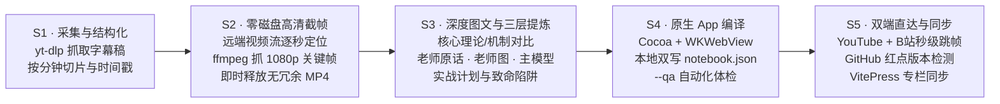

# YouTube 课程体系化研学与学习室 App 脚手架 (Created by Xiao Ang)

> **Created by Xiao Ang** · 通用视频课程提炼、图文精读与 macOS 原生桌面学习室脚手架。

将任何复杂的 YouTube 视频合集（如专业交易、计算机架构、AI 算法、游戏引擎、外语学习等）转化为**沉浸式、结构化、具备本地持久化与原生桌面体验的交互学习室**。

---

## 🚀 核心工作流：五阶段流水线 (`S1–S5`)



---

## 🛠️ 按请求进入操作指引

| 用户请求类型 | 行动与推荐工具 | 产出物与规范 |
| :--- | :--- | :--- |
| **接入新课程（从 YouTube 链接开始）** | 运行 `template/scripts/extract_subs.py --url <URL>` 抓取字幕稿与元数据，建立 `transcripts/` 切片。 | 生成 `transcripts/{ep}_{videoId}.md` 逐分钟英文切片与 `courseData.json` 骨架。 |
| **截取代表性图解（零磁盘开销）** | 运行 `template/scripts/extract_keyframes.py`，根据时间戳直接拉取 1080p 流截取 PNG。 | 生成 `lesson-assets/` 高清原图，**严禁在磁盘上遗留几百 MB 的 MP4 文件**。 |
| **撰写深度讲义与提炼卡片** | 参考 [references/distillation-guide.md](references/distillation-guide.md)，撰写图文手册并生成 `distill-data.js` 与 `library-data.js`。 | 必须包含：**核心原理、盘面/代码抓手、三层提炼（老师/老师图/主模型）、执行清单与避坑指南**。 |
| **编译 macOS 原生应用** | 进入项目 `study-room/native/` 运行 `./build.sh`，生成 `~/Desktop/{课程名} 学习室.app`。 | 必须运行 `--qa` 自动化测试，验证所有课程与图片 100% 加载成功。 |
| **配置红点同步检测** | 运行 `build_study_room.py` 自动写入 `version.json` 与 `version.js`，启动 GitHub Commit 追踪。 | 当本地数据慢于远程仓库时，UI 自动激活呼吸红点提示与更新弹窗。 |

---

## 📚 参考文档索引

- [references/methodology.md](references/methodology.md)：5 阶段全流程方法论与执行规范。
- [references/architecture.md](references/architecture.md)：纯原生 Swift + WKWebView 双写架构、消息通道与 `--qa` 原理。
- [references/zero-disk-keyframing.md](references/zero-disk-keyframing.md)：零磁盘持久占用的远端视频流 1080p 关键帧抓取技术详解。
- [references/distillation-guide.md](references/distillation-guide.md)：三层知识提炼模型规范（老师原话 / 原片图表 / 主模型归纳）。

---

## 📋 脚手架目录标准

新建学习室项目时，克隆并初始化如下结构：

```text
{my-course}-study-room/
├── README.md                          # 项目介绍、截图展示与一键上手
├── {COURSE}_图文精读手册.md           # 深度图文讲义全集
├── courseData.json                    # 课程元数据、分集、时间轴与术语
├── transcripts/                       # 逐分钟/自然段切片原文字幕稿
├── scripts/
│   ├── extract_subs.py                # 字幕与元数据抓取脚本
│   ├── extract_keyframes.py           # 远端流零磁盘截帧工具
│   └── build_study_room.py            # 数据包编译器 (生成 JS / version)
└── study-room/                        # 学习室交互工作台
    ├── index.html                     # 学习室主页面
    ├── style.css / distill.css        # 纸感优雅墨绿主题样式
    ├── app.js / distill.js            # 交互逻辑、双跳秒与红点检测
    ├── distill-data.js                # [自动生成] 三层提炼数据卡
    ├── library-data.js                # [自动生成] 富文本讲义与切片
    ├── version.json / version.js      # [自动生成] Git 版本与同步元数据
    ├── lesson-assets/                 # 1080p 关键帧图库 (*.png)
    ├── notebook.json                  # [运行时] 用户笔记与练习记录
    └── native/                        # macOS 原生封装
        ├── App.swift                  # Cocoa Swift 容器
        ├── Icon.swift                 # 矢量图标生成器
        ├── Info.plist                 # Bundle 配置
        └── build.sh                   # 一键编译与签名脚本
```

---

## ⚠️ 纪律与约束

1. **零大文件入库**：永远不要将庞大的 `.mp4` 视频文件提交至 Git 仓库，视频跳转采用 `🎬 YT` 与 `📺 B站` 秒级时间戳直达；
2. **三层提炼严谨性**：每一张提炼卡必须严格核读原片上下文，明确区分「导师原话」「原片图表事实」「归纳主模型」；
3. **署名规范**：保留 `Created by Xiao Ang` 署名与学术框架声明。
